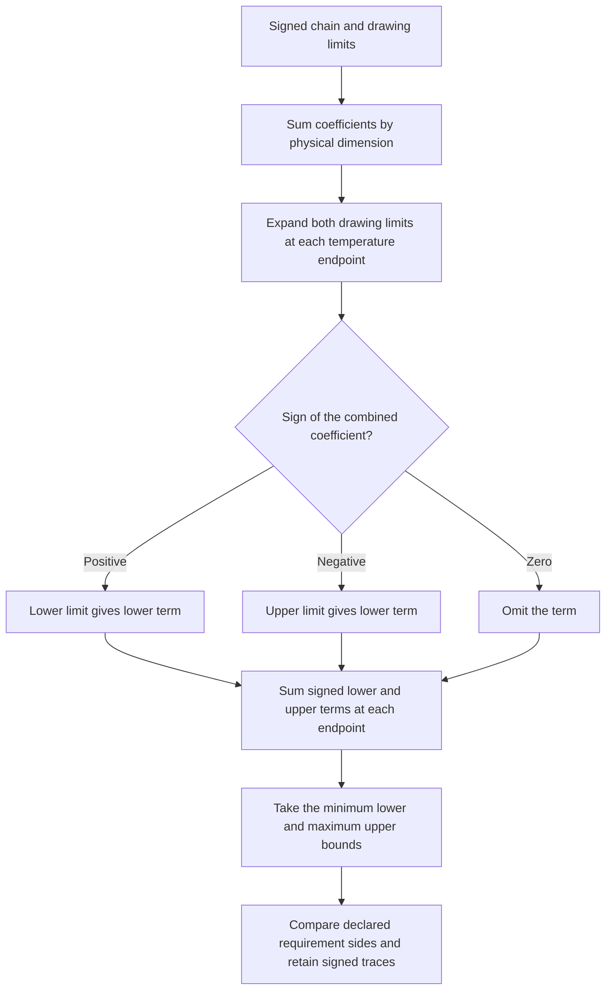
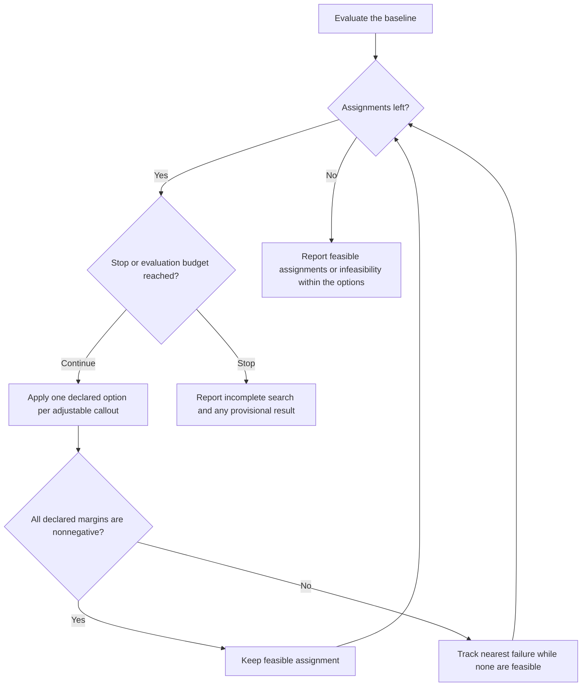

# StackOpt architecture and build plan

StackOpt is a local Python tool for worst-case dimensional tolerance analysis and allocation. The first release reads selected dimensions from a SOLIDWORKS assembly, combines them with engineering requirements supplied by the user, and reports which candidate drawing tolerances satisfy those requirements across a temperature range. The same CLI accepts manually entered dimensions and can replay a saved analysis without CAD installed.

## Runtime architecture

```text
Case file ───────────────────────────────────────┐
                                                  v
CAD app → read-only adapter → dimension data → input resolver → analysis snapshot
                                                                         |
                                                                         v
Terminal / JSON report ← analysis result ← interval evaluator / allocator
```

One Python package and one CLI. Use `argparse`, JSON and ordinary Python modules for the initial implementation. Keep `pywin32` as an optional Windows dependency confined to the SOLIDWORKS adapter. The mathematical model is deterministic and runs in the CLI process. Files provide the reproducibility boundary. A database, API server and custom interface are outside the first release.

| Code area | Responsibility |
|---|---|
| `case.py` | Validate cases and extraction records, normalize units, and resolve explicit inputs and CAD evidence. |
| `snapshot.py` | Persist resolved inputs atomically and validate snapshots for offline replay. |
| `analysis.py` | Compute worst-case bounds and margins for a signed 1D chain at the specified temperatures. Accept validated data and return structured results. |
| `allocation.py` | Evaluate candidate tolerance combinations using the same analysis function. Rank feasible combinations only when the case supplies a comparable objective. |
| `adapters/solidworks.py` | Read bound dimensions from the active assembly. Resolve occurrence and referenced configuration, interpret supported tolerance types and return source values, units and references for the resolver. |
| `adapters/freecad.py` | Export explicit native cylinder lengths from a single active FreeCAD document. The CLI consumes the exported records through the same resolver. |
| `cli.py` and `report.py` | Orchestrate extraction, analysis and allocation. Write concise terminal summaries and machine-readable results. |

The adapter returns dimensional data, never a clearance or an allocation decision. The evaluator receives lengths and tolerances without CAD-specific objects. Add a second adapter against the same data contract before designing a general plugin system.

## Input and output contracts

- **Case file.** Schema version, logical dimension IDs, CAD bindings or manual nominal dimensions, signed chain coefficients, baseline tolerance source, reference and operating temperatures, expansion coefficients, acceptable clearance bounds, and allowed candidate tolerances. A dimension with no allocation options retains its baseline tolerance. First release defaults to one named functional chain per case, with joint evaluation conditional on the first real assembly. Require at least one clearance limit.
- **Extraction record.** Logical ID, nominal dimension, explicit lower and upper tolerance deviations when supported, document identifier, occurrence, referenced configuration, dimension identifier and extraction diagnostics. If the source is an unsaved CAD state, label it as such. Drawing-specific, missing and unsupported tolerances require an explicit value in the case before evaluation. If the case selects manual tolerance and a CAD tolerance also exists, show the chosen source and flag discrepancies.
- **Analysis snapshot.** Versioned JSON with every resolved input required to replay the calculation. Normalize lengths to mm, temperatures to °C and expansion coefficients to K⁻¹. Reject invalid intervals, non-finite numbers, incompatible units, missing or ambiguous bindings, and invalid model assumptions. The snapshot records the values used even when the CAD document subsequently changes.
- **Result.** Baseline and proposed drawing limits, minimum and maximum functional clearance, controlling temperature for each bound, signed margins, and the ranking basis. Distinguish invalid input, an infeasible search, and a search that did not complete. When candidate rankings lack a defensible objective, show feasible choices without declaring a winner. Keep calculation values at full supported precision until display formatting and test boundary comparisons explicitly.

Commands for CAD extraction and replay:

```powershell
stackopt extract solidworks --active --case shaft-fit.json --out snapshot.json
stackopt extract freecad --records freecad-records.json --case freecad-case.json --out freecad-snapshot.json
stackopt analyze snapshot.json
stackopt allocate snapshot.json --json result.json
```

`extract` resolves the case into a replayable snapshot. For a fully manual case, `analyze` and `allocate` can read it directly through the same validation path. The live integration targets a running SOLIDWORKS desktop session with a resolved assembly. It reads the model and reports unsupported assembly states. It does not modify or save CAD files.

For FreeCAD, run `stackopt.adapters.freecad.export_active(case_path, records_path)` in FreeCAD's Python runtime before invoking `extract`. The exported file is a JSON array of v1 extraction records. The caller selects the intended native document before export. StackOpt validates the record batch against the case and resolves it without loading FreeCAD. [CAD setup and verification](docs/usage.md#cad-extraction)

## Engineering model

Represent the functional quantity as a signed linear chain. Combine repeated references to the same physical dimension before interval propagation so one dimension cannot take two different values in the same assembly. Distinct manufactured occurrences can vary independently even when they reference the same CAD file. Occurrences of the same specific dimension callout and applicable revision/configuration share the allocation choice. Other dimensions on the same drawing have separate choices.

Expand both drawing limits using the same positive thermal expansion factor for a dimension. At a given temperature, a negative chain coefficient swaps which limit contributes to the lower and upper bounds. Under the baseline assumptions of free expansion, constant material coefficients and a common uniform part temperature, both functional bounds are affine in temperature. Evaluate both at the two endpoints. Supported tolerance deviations may be asymmetric or unilateral. The result describes dimensional worst cases under the supplied assumptions, without a failure probability.



## Allocation search

Start with exhaustive enumeration of user-defined discrete options. Report the total combination count and identify incomplete searches explicitly. When comparable cost or penalty scores are supplied, use them consistently and document how ties are ordered. Treat synthetic penalty scores as examples and keep price claims tied to actual quotes. If real cases make enumeration too slow, consider a mixed-integer linear formulation for additive costs and linear constraints. Compare its results with exhaustive enumeration on small cases and independently recheck the reported allocation. [SciPy MILP documentation](https://docs.scipy.org/doc/scipy/reference/generated/scipy.optimize.milp.html)



Each option applies to every occurrence of its qualified callout. The CLI supports stopping between candidates with `Ctrl+C`, `--max-evaluations` and `--max-seconds`. The same budgets are available through the allocator's Python entry point.

## CAD support roadmap

Priorities describe planned support. Each adapter earns a support claim by passing the same replay and source-tracing checks on a real model.

| Target | Proposed extraction | Priority and constraint |
|---|---|---|
| SOLIDWORKS | Windows COM from an open, resolved assembly. Read named dimensions from each selected occurrence's referenced configuration. Accept explicitly supported model tolerance annotations after checking status and type. | First native adapter. Prototype with two top-level components. Qualify tolerance types and configuration behavior on the installed version. [Dimensions](https://help.solidworks.com/2024/english/api/sldworksapi/solidworks.interop.sldworks~solidworks.interop.sldworks.idimension~getsystemvalue3.html) · [Referenced configuration](https://help.solidworks.com/2025/English/api/sldworksapi/SOLIDWORKS.Interop.sldworks~SOLIDWORKS.Interop.sldworks.IComponent2~ReferencedConfiguration.html) · [Tolerance status](https://help.solidworks.com/2026/english/api/sldworksapi/SOLIDWORKS.Interop.sldworks~SOLIDWORKS.Interop.sldworks.IDimensionTolerance~GetMaxValue2.html) |
| FreeCAD | Export explicit `App::PropertyLength` values on native `Part::Cylinder` objects by internal object name and property name. Supply tolerances explicitly in the case. | Qualified on one recomputed FCStd fixture in FreeCAD 1.1.4 on Windows x64. [CAD guide](docs/usage.md#freecad) · [FreeCAD document objects](https://freecad.github.io/Addon-Academy/Guides/Code/Document-Objects/) |
| Autodesk Fusion | In-app Python script exports named user parameters. Convert database length units from cm to mm. | Candidate after FreeCAD, if a reviewer needs it. A desktop integration can start with a script rather than a packaged add-in. [Fusion scripts](https://help.autodesk.com/cloudhelp/ENU/Fusion-360-API/files/WritingDebugging_UM.htm) · [Named parameters](https://help.autodesk.com/cloudhelp/ENU/Fusion-360-API/files/fusion_UserParameters_itemByName.htm) · [Units](https://help.autodesk.com/cloudhelp/ENU/Fusion-360-API/files/Units_UM.htm) |
| Onshape | Authenticated REST connector scoped to explicit document/version, element, and configuration. Spike named variable or feature parameter extraction first. | Candidate when a cloud workflow is needed. Adds credential handling, network failures and version handling. [Onshape API architecture](https://onshape-public.github.io/docs/api-intro/architecture/) · [API authentication](https://onshape-public.github.io/docs/auth/apikeys/) |
| Autodesk Inventor | Read named parameters via its desktop API. Verify model-state resolution and tolerance extraction before promising support. | Candidate when a reviewer has an Inventor case. [Inventor Parameters API](https://help.autodesk.com/cloudhelp/2025/ENU/Inventor-API/files/Parameters.htm) |

STEP AP242 is a potential interchange format, with semantic and graphical product manufacturing information depending on the contents of the actual export. Start with named native parameters. Consider STEP ingestion when a specific use case needs it, with sample exports that demonstrate the required semantic annotations and associations. [NIST STEP File Analyzer and Viewer](https://www.nist.gov/services-resources/software/step-file-analyzer-and-viewer)

## ML decision

The first release uses equations, explicit input rules and deterministic search. A trained model has no task in calculating dimensional bounds or selecting among fully specified options. A language model would have to guess at functional intent or manufacturing capability if those inputs were missing.

A future research question is whether supplier-specific quote or process data can predict the penalty for tightening a tolerance. That requires representative measurements or quotes, comparisons against simple baselines, validation on held-out jobs and uncertainty estimates. Predictions could inform a ranking. The hard feasibility check would still use the deterministic evaluator. Automatic interpretation of design intent is a separate research problem.

## Coding sequence and acceptance gates

The synthetic fixture uses a 20.100 mm aluminium bore and 20.000 mm steel shaft at 20 °C, with expansion coefficients of 23 and 12 µm/(m·K), respectively. The clearance must stay between 0.050 and 0.150 mm from −20 to 60 °C. Both dimensions start at ±0.025 mm with zero penalty. The tighter bore option is ±0.015 mm at penalty 1, and the tighter shaft option is ±0.010 mm at penalty 3. The winning allocation has approximately 0.0511338 to 0.1489178 mm clearance, with about 0.0010822 mm of limiting margin at 60 °C.

| Stage | Work | Gate |
|---|---|---|
| 1. Benchmark and API spike | Document the bore and shaft calculations and create a two-part assembly with named diameters. Verify the installed SOLIDWORKS API can read both nominal lengths and at least one supported model tolerance. Work on the hand calculation and CAD spike independently. | Read 20.100 mm and 20.000 mm from the intended occurrences. Switch the referenced configuration or change a dimension and verify the next extraction reads the intended value. |
| 2. Engine and replay | Implement case validation, signed intervals, thermal expansion and manual analysis. Add automated tests using hand calculations and exhaustive dimensional-corner checks for small chains. | At −20 to 60 °C the baseline clearance is approximately 0.0411 to 0.1589 mm. Tests cover asymmetry, equal boundaries, invalid inputs and a repeated dimension. |
| 3. Allocation | Enumerate the tolerance options and expose baseline and candidate margins through the CLI. | The example chooses the ±0.015 mm bore with the ±0.025 mm shaft. Cases cover infeasibility, ties and absent ranking data. |
| 4. SOLIDWORKS integration | Turn the API spike into the adapter. Verify model tolerance status, units, configuration, absent dimensions and unresolved components. Keep numerical tests runnable without CAD. | A real extraction produces the hand-checked result. After editing and rebuilding the CAD model, a fresh extraction changes the result predictably and the original snapshot still replays independently. |
| 5. Engineering review | Run a real case with plausible tolerance choices and a named decision such as changing a drawing callout. | Record what decision the output changed or what evidence is missing. The FreeCAD portability benchmark has its own extraction and replay checks. |

If the CAD spike establishes reliable nominal reads but finds unsupported tolerances, continue with explicit case-file tolerances and make the source visible. Keep a custom UI out of the first release. If binding dimensions by name is the main friction in the review, test a CAD-side selection command that fills in those bindings.

## Actionable results and release checks

- Require at least one clearance limit. Always report both physical clearance bounds. For each declared requirement side, identify its signed margin and controlling temperature.
- For the baseline and reported candidate, include signed dimensional contributions to each physical bound. Show changed callout limits and the change in each declared margin. Attribute contribution changes at a common temperature and side, and explicitly identify any shift in the governing temperature.
- When no evaluated option passes, report the closest tested candidate by minimum maximum violation across declared sides in mm, with stable candidate order for ties. Show its margins and temperatures as a diagnostic. A stopped search qualifies the candidate as closest evaluated so far. With zero evaluated candidates, leave the diagnostic candidate absent.
- Before freezing support for the first real assembly, check whether an adjustable callout affects multiple requirements. If it does, apply each candidate assignment across every affected chain and surface the limiting requirement and side. Otherwise identify the single-chain result scope. Try CAD binding discovery only if the live trial shows that locating identifiers is the bottleneck.
- The first actionable report check asks which requirement and side failed, which signed terms drove the bound, and what permitted change recovers how much margin. Include min-only, max-only, two-sided, genuinely infeasible and interrupted cases. The bore-only example must show the upper margin moving from −8.9270 µm to +1.0822 µm, a gain of 10.0092 µm.
