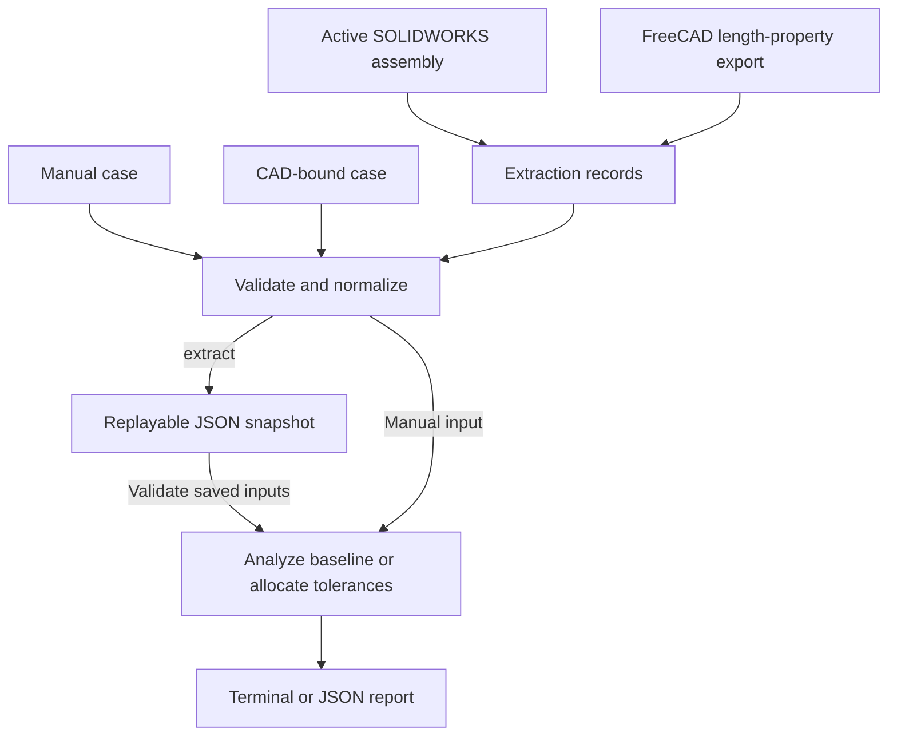

# StackOpt

[](https://github.com/isathinsitha/stackopt/actions/workflows/tests.yml)

StackOpt is a Python CLI for worst-case dimensional tolerance analysis. Give it a signed dimension chain, a clearance requirement, and permitted drawing tolerances. It computes the clearance envelope over a temperature range and checks which tolerance combinations satisfy the requirement. Reports identify the dimensions and temperatures that control each bound.

**Status** · Development build (`0.1.0.dev0`). The numerical model, CAD extraction paths, and offline replay have been checked against synthetic fixtures. A representative engineering assembly review is pending.

## Quick start

From the repository root with Python 3.11 or later:

```bash
python -m pip install .
stackopt analyze examples/acceptance-v1/manual-case.json
stackopt allocate examples/acceptance-v1/manual-case.json --json allocation.json
stackopt analyze examples/acceptance-v1/cad-shaped-snapshot.json
```

`python -m stackopt` runs the same CLI. Manual analysis and snapshot replay use the Python standard library at runtime and work without CAD installed.

## Worked example

The [bore and shaft case](examples/acceptance-v1/manual-case.json) requires a diametral clearance of **0.050–0.150 mm** over **−20 to 60 °C**. The bore is 20.100 mm and the shaft is 20.000 mm at 20 °C. Both start with ±0.025 mm size tolerances.

| | Bore tolerance | Shaft tolerance | Clearance envelope | Upper margin |
| --- | --- | --- | --- | --- |
| Baseline | ±0.025 mm | ±0.025 mm | 0.041143–0.158927 mm | −8.9270 µm |
| Lowest-penalty feasible assignment | ±0.015 mm | ±0.025 mm | 0.0511338–0.1489178 mm | +1.0822 µm |

The solver checks all four supplied assignments. Three are feasible. Tightening the bore alone recovers 10.0092 µm of upper margin and has the lowest supplied penalty. The benchmark uses illustrative scores. [Hand calculation and acceptance fixtures](examples/acceptance-v1/README.md)

## Data flow



`analyze` computes the baseline envelope. `allocate` also evaluates the declared drawing options and ranks feasible assignments when the case supplies comparable scores. `extract` captures CAD provenance and writes a frozen snapshot. See the [CLI and CAD guide](docs/usage.md) for commands and exit codes, and the [architecture](ARCHITECTURE.md) for the evaluator and allocation flowcharts.

## Model scope

Each case contains one signed linear dimensional chain and one requirement with a minimum, a maximum, or both. The solver uses worst-case drawing intervals, free thermal expansion, constant coefficients, and one uniform temperature shared by the parts. A shaft-rub prediction needs a local-gap model that also accounts for relevant alignment, deformation, and part temperatures.

Live CAD support is qualified on the SOLIDWORKS 2026 SP2.1 fixture and the FreeCAD 1.1.4 Windows x64 fixture. SOLIDWORKS reads explicitly bound assembly dimensions and supported model tolerances. FreeCAD exports supported native cylinder length properties and uses drawing tolerances supplied in the case. Both adapter paths read the CAD model without writing changes to it. [CAD setup and qualification scope](docs/usage.md#cad-extraction)

## Verify or explore

```bash
python -B -m unittest discover -s tests -v
```

The suite checks the installed CLI, snapshot replay, adapter record validation, and exact numerical results against a separate dimensional-corner oracle. The [JSON contract](STACKOPT_CONTRACTS_V1.md) describes the file formats. The [interactive architecture editor](stackopt-workspace/README.md) runs separately with Node.js.
